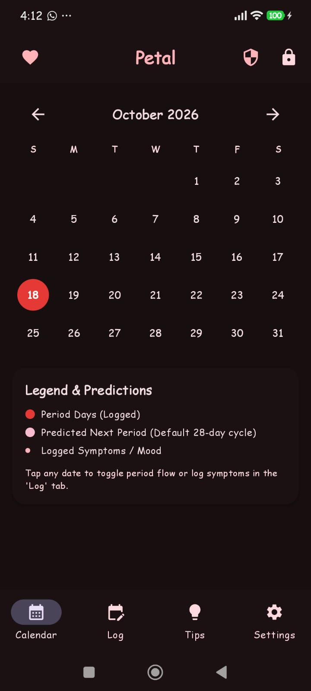
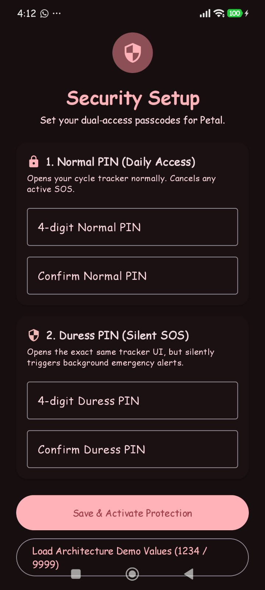
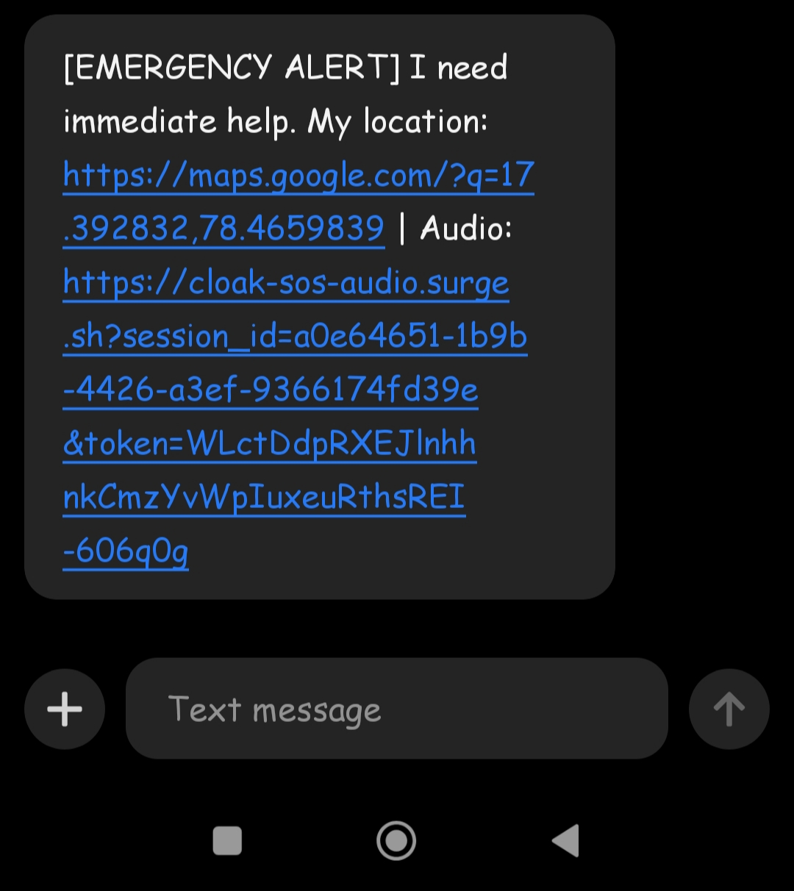
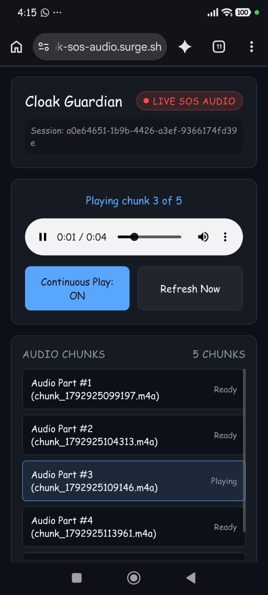
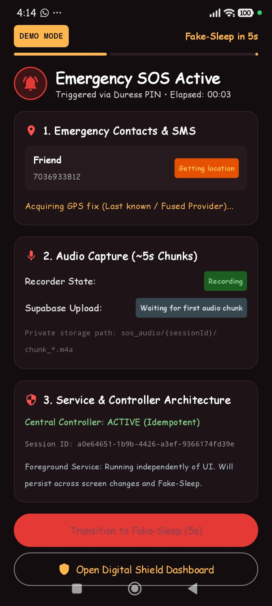
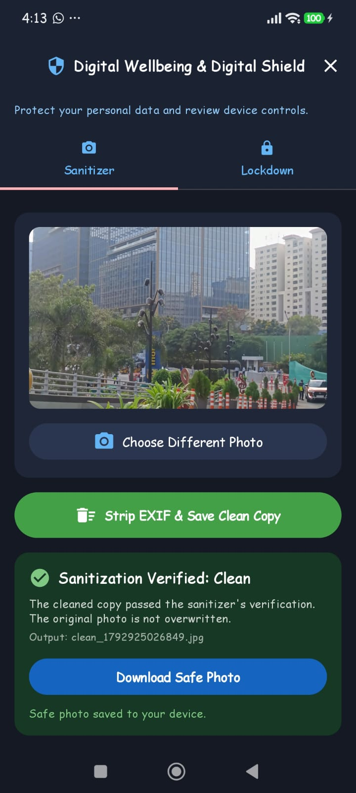
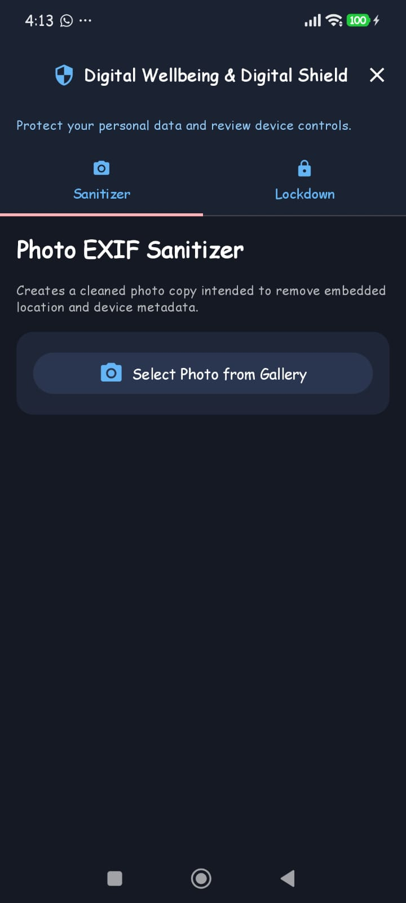

# Cloak — Personal Safety & Digital Wellbeing App

Cloak is an Android application designed to support personal safety during emergencies and provide digital wellbeing features. It combines an SOS workflow, emergency communication, location sharing, remote audio access, and photo sanitization in one application.

## Table of Contents

- [Overview](#overview)
- [Key Features](#key-features)
- [Screenshots](#screenshots)
- [Project Structure](#project-structure)
- [Technology Stack](#technology-stack)
- [How It Works](#how-it-works)
- [Getting Started](#getting-started)
- [Build the APK](#build-the-apk)
- [Privacy and Security](#privacy-and-security)
- [Limitations](#limitations)
- [Future Improvements](#future-improvements)
- [Author](#author)

## Overview

Cloak focuses on two areas:

1. **Personal Safety:** Emergency messaging, location sharing, audio recording, and remote access to emergency audio.
2. **Digital Wellbeing:** Photo sanitization and controls related to Wi-Fi, Maps/location, and Bluetooth.

The application has been built using Kotlin and Jetpack Compose. Its SOS workflow has been tested on a physical Android device, including emergency SMS delivery, location sharing, and remote audio playback.

## Key Features

### 1. SOS Emergency Workflow

- Send emergency SMS messages to a configured trusted contact.
- Share location through a link.
- Record emergency audio in chunks.
- Upload emergency audio recordings to Supabase Storage.
- Use a session-specific remote audio player link.
- Use the `cloak-sos-access` Supabase Edge Function to support controlled access to emergency audio.

### 2. Digital Wellbeing

- Photo sanitization to support safer photo sharing.
- Controls related to Wi-Fi.
- Controls related to Maps and device location.
- Controls related to Bluetooth.

*The exact behavior of system-setting controls may depend on Android permissions, operating-system restrictions, and the device.*

### 3. Backend and Remote Audio Access

- Supabase backend integration.
- Supabase Storage for emergency audio files.
- A Supabase Edge Function for controlled audio access.
- A web-based remote audio player hosted on Surge.

## Screenshots

| Home Screen | SOS Setup | Emergency SMS | Audio Player |
|---|---|---|---|
|  |  |  |  |

| Active SOS | Photo Sanitization | Digital Wellbeing Controls |
|---|---|---|
|  |  |  |

## Project Structure

The main Android application follows a typical Kotlin and Jetpack Compose project layout.

```text
Petal/
├── app/
│   ├── src/
│   │   └── main/
│   │       ├── java/
│   │       │   └── <your-package>/
│   │       │       └── Kotlin source files
│   │       ├── res/
│   │       │   └── Android resources
│   │       └── AndroidManifest.xml
│   ├── build.gradle.kts
│   └── build/
│       └── outputs/
│           └── apk/
│               └── debug/
│                   └── app-debug.apk
├── gradle/
│   └── wrapper/
├── screenshots/
│   ├── 01-home-screen.jpeg
│   ├── 02-sos-setup.jpeg
│   ├── 03-emergency-sms.jpeg
│   ├── 04-audio-player.jpeg
│   ├── 05-sos-active.jpeg
│   ├── 06-photo-sanitization.jpeg
│   └── 07-digital-wellbeing-controls.jpeg
├── .gitignore
├── build.gradle.kts
├── gradlew
├── gradlew.bat
├── settings.gradle.kts
└── README.md
```

**Structure notes:**

- `app/src/main/java/` contains the Kotlin application source code.
- `app/src/main/res/` contains Android resources.
- `app/src/main/AndroidManifest.xml` declares app components and permissions.
- `app/build.gradle.kts` contains the Android app's Gradle configuration.
- `screenshots/` stores the seven images displayed in this README.
- `gradle/wrapper/` contains the Gradle wrapper files.
- `app/build/outputs/apk/debug/app-debug.apk` is the generated debug APK after a successful build.

The tree above illustrates the main project layout. Keep the actual package name and any additional folders or files that exist in your repository; do not create placeholder folders solely to match this example.

## Technology Stack

| Technology | Purpose |
|---|---|
| Kotlin | Android application development |
| Jetpack Compose | Android user interface |
| Gradle | Build automation |
| Android SMS APIs | Emergency messaging |
| Android location capabilities | Location sharing |
| Android audio recording | Emergency audio capture |
| Supabase | Backend services |
| Supabase Storage | Emergency audio storage |
| Supabase Edge Functions | Controlled audio access |
| Surge | Hosting the remote audio player |

## How It Works

### SOS Workflow

1. The user initiates the SOS workflow in the Android application.
2. Cloak sends an emergency SMS to the configured trusted contact.
3. Location can be shared through a link.
4. Emergency audio is recorded in chunks and uploaded to Supabase Storage.
5. The remote audio player uses a session-specific link, with access supported by the `cloak-sos-access` Edge Function.

### Digital Wellbeing Workflow

1. The user opens the Digital Wellbeing features.
2. The user can access photo sanitization.
3. The user can use the available controls related to Wi-Fi, Maps/location, and Bluetooth.

## Getting Started

### Prerequisites

- A compatible Android device or emulator.
- Android Studio or another suitable development environment.
- JDK 17.
- Android SDK and the required SDK components.
- Access to the required backend configuration for features that use Supabase.

### Clone the Repository

```bash
git clone https://github.com/ramshazameer016-ai/cloak.git
cd cloak
```

Open the project in Android Studio, or use the terminal with the required Android development tools installed.

### Configure the Backend

Configure the Supabase project and any other required service settings according to the application's implementation.

Do not commit private API keys, service-role keys, access tokens, passwords, or other secrets to GitHub.

## Build the APK

On Windows, open PowerShell in the project directory and run:

```powershell
$env:JAVA_HOME = "D:\CloakTools\Java\jdk-17"
.\gradlew.bat assembleDebug
```

After a successful build, the debug APK should be available at:

```text
app/build/outputs/apk/debug/app-debug.apk
```

You can install the APK on a compatible Android device for testing. A debug APK is intended for development and testing, not as a production release.

## Privacy and Security

- Emergency contact details and location information should be handled carefully.
- Emergency audio can contain sensitive personal information.
- Backend access should be restricted to authorized sessions and users.
- Keep private credentials outside source control.
- Review Android permissions and backend access policies before deployment.
- Avoid publishing screenshots that expose phone numbers, private locations, access tokens, or sensitive audio links.

## Limitations

- Emergency SMS delivery depends on device permissions, mobile network availability, and device configuration.
- Location sharing depends on location permissions and the availability of location data.
- Audio recording and upload depend on permissions, connectivity, storage, and backend availability.
- Remote audio access depends on correct backend configuration and access controls.
- Android restricts some applications from directly changing system settings; behavior can vary by Android version and device.
- Cloak is a personal safety support tool and does not replace emergency services.

## Future Improvements

- Improve reliability when network connectivity is limited.
- Add clearer SOS status and upload feedback.
- Strengthen session expiry and access-control handling for remote audio.
- Expand privacy-focused photo handling.
- Improve accessibility and usability across Android devices.
- Conduct additional security and usability testing.

## Author

**Ramsha Zameer**

- GitHub: [@ramshazameer016-ai](https://github.com/ramshazameer016-ai)
- Project Repository: [Cloak](https://github.com/ramshazameer016-ai/cloak)

*Always learning. Always building.*
